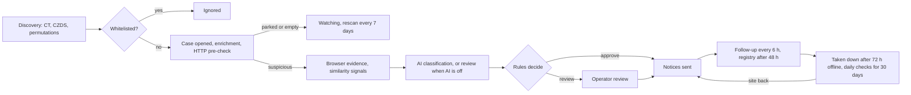

# Kalkan product description

This document describes what Kalkan does and the rules it follows. How it is built is in [architecture.md](architecture.md); the reasons behind individual choices are in [decisions.md](decisions.md). Code comments refer to the numbered sections here as `product.md §N`.

The demo data uses a fictional digital bank, **Mintera Bank** (short form: Mintera), with official domains `mintera.com` and `mintera.pl`.

## 1. Summary

Kalkan is a managed brand-protection service for online brands. It finds websites that imitate a brand (live phishing clones and lure pages), verifies them with browser evidence, rules and optional AI classification, sends takedown notices to the right abuse desks and keeps checking each site until it is gone.

The customer only maintains a whitelist of their own and their partners' domains and follows the results in a web panel. Detection, review and notices are run by an operator, who works in a separate internal panel.

## 2. Problem

- Banks, payment apps and other online brands are imitated constantly. Fake sign-in and card-verification pages steal customers' credentials and money, and the complaints and the loss of trust land on the brand.
- Clones appear fast: a new domain, a free TLS certificate and often a server hidden behind a CDN. Searching and reporting by hand is slow and inconsistent.
- Abuse desks act quickly on well-documented reports. A report with weak evidence waits or is rejected.

## 3. Users and roles

| Role | Who | What they do |
| --- | --- | --- |
| Owner | The customer's brand, security or partner manager | Uses the panel, manages the whitelist, invites users, reads reports |
| Viewer | Other people on the customer's team | Reads the panel |
| Operator (staff) | The team running the service | Onboarding, review queue, manual channels, settings; only in the internal ops panel |
| Abuse desk (indirect) | Registrars, registries, hosting providers | Receives the notice and the evidence page, replies by e-mail |

## 4. Service model

| Phase | Customer | Operator and system |
| --- | --- | --- |
| Start | Brand details, official domains, partner list, logos, letter of authorization (LOA) | Sets up the account, captures reference screenshots, imports the whitelist |
| Ongoing | Keeps the whitelist current, follows the panel | Discovery, verification, review, notices, follow-up, monthly report |
| Exception | Reports a false positive with "This is our site" | Retracts any notice sent, adds the domain to the whitelist |

The customer does not start or edit notices from the panel. Sent notices are visible read-only.

## 5. Scope

**Included**

- Two domain-based threat types: live phishing clones and lure pages (§6)
- Discovery: Certificate Transparency (CT) stream, dnstwist-style permutations, ICANN CZDS zone files
- Verification: HTTP pre-check, desktop and mobile evidence from a headless browser, perceptual hash and favicon matching, form detection
- AI classification and notice explanations (optional; without AI the same cases go to human review)
- Managed takedown through registrar, registry and hosting abuse channels; manual reports to Google Safe Browsing
- Follow-up: periodic rechecks, 72-hour takedown confirmation, escalation, reopening
- Customer panel: overview, threats, threat detail, whitelist, reports, settings
- Ops panel: onboarding, labelling, review queue, manual channel tasks, settings
- Monthly PDF and CSV reports

**Not included**

- Social media, messaging apps, app stores and search ads
- Other abuse types; copyright (DMCA, DSA) notices
- Cloudflare's abuse channel (sites behind a proxy are taken down through the registrar and registry)
- Paid newly-registered-domain (NRD) feeds
- Customer identity checks, contract management, billing
- Notices started by the customer, self-service sign-up
- A translated interface (the panel is English only)

## 6. Concepts

| Term | Meaning |
| --- | --- |
| Candidate | A domain from a discovery source that matches a brand keyword or one of its permutations |
| Threat (case) | A candidate that passed the whitelist and matches a customer's brand. "Threat" in the panel, `case` in the code |
| Phishing clone | A fake site that mirrors the original live. It relays the user name, password and one-time code to the real site, takes over the account and drains it, and may show the real account to ask for a further "verification" payment. The highest priority type; `phishing_clone` in the code |
| Lure page | A page that poses as the bank's support, refund or account-verification page. Its buttons send visitors to a fake site or to an unrelated third party. `brand_impersonation` in the code; when the buttons lead to the official site the page is treated as a referral, comparison or review site (`affiliate_or_review`) |
| Verified | Confirmed as a threat by the AI plus code checks, or by an operator |
| Approved | The notice was approved by the rules or by an operator |
| Notice | A takedown request sent to one channel (registrar, registry, host, Google) |
| Taken down | A site that has been unreachable for at least 72 hours without a break |
| Watching | A parked or empty page; rescanned every 7 days |
| Dismissed | Not a threat: affiliate, review site, unrelated site or the customer's own site |
| Evidence package | Screenshots, HTML, HAR, DNS and RDAP records and their hashes; immutable for 180 days |
| LOA | Letter of authorization: the customer's permission to send notices on their behalf |
| Kill switch | A global setting that stops all real sending at once |
| Dry-run | Notices go to the operator's mailbox instead of the real recipient. Global and per customer; on by default for new customers |
| Monitor-only brand | A brand watched to collect evaluation data; no notice is ever prepared |

## 7. End-to-end flow

1. Discovery finds a new domain (CT, CZDS or a permutation scan).
2. The domain matches a brand. If it is whitelisted it is dropped silently; otherwise a case is opened (Reviewing in the panel).
3. DNS, RDAP and hosting details are collected and an HTTP pre-check runs.
4. A parked or empty site goes to Watching and is rescanned every 7 days.
5. A suspicious site gets mobile and desktop evidence from the target market, and the similarity signals are computed.
6. The AI classifies the page (or, with AI off, the case goes to an operator). The rule engine decides: automatic approval, human review, watching or dismissal.
7. An approved case gets notices on the right channels (Notice sent).
8. The site is checked every 6 hours. If it is still up 48 hours later the notice is escalated to the registry.
9. When the site has been down for 72 hours without a break the case is closed (Taken down) and checked daily for 30 days. If it comes back the case reopens.
10. The customer sees every step in the panel and gets a report at the end of the month.

## 8. Onboarding

The operator runs onboarding. The customer provides the details through a form or by e-mail.

| Item | Required | Used for |
| --- | --- | --- |
| Brand names and spelling variants | Yes | Discovery keywords, permutations |
| Official domains (active, old, backup, alternate) | Yes | Whitelist and reference screenshots |
| Affiliate and partner domains (one by one or CSV) | Yes | Whitelist; the most common source of false positives |
| Logo (SVG/PNG, light and dark) and favicon | Yes | Visual matching and AI reference |
| Target markets and languages | Yes | Proxy country, notice language, time zone |
| Letter of authorization (LOA) | Before sending | Notices on the customer's behalf |
| Alert e-mail | No | Alerts about new phishing clones |
| Official social media accounts | No | Whitelist (a social module is out of scope) |
| Campaign visuals, app screenshots | No | Extra AI reference |
| Trademark registration numbers | No | Trademark notice templates |

The customer is not asked for screenshots. The system captures the official sites' reference screenshots itself, at the same resolution and up to date.

Setup order:

1. Customer record, brands and official domains
2. Logos and favicon
3. Whitelist import
4. Reference screenshots
5. Invitation to the owner
6. LOA upload
7. Sending turned on for the customer (dry-run stays on)
8. 48 hours of dry-run: notices go only to the operator's mailbox as previews; cases show as "Active" in the panel
9. Dry-run turned off for the customer; real sending starts

## 9. Customer panel

The interface is in English. The default theme is light; users can choose dark or follow the system setting. The panel works on a phone.

**Shell**

- Left menu: Overview, Threats (with a badge of open threats), Whitelist, Reports; Settings at the bottom
- Top bar: brand selector, date range (7, 30, 90 days and custom), notifications, user menu
- A "Demo workspace" label on the demo account

**Overview**

- Live-threats banner: how many threats are still live ("8 threats are still live"), with a link to them
- Four KPI cards, each with the change against the previous period: Detected, Verified threats, Taken down (with the share of verified), Median takedown time
- Daily detections and takedowns as an area chart (7, 30, 90 days)
- Status breakdown: Reviewing, Active, Notice sent, Taken down, Watching, Dismissed (the Reviewing row shows only when its count is above zero)
- Recent threats, newest first: domain and type, status, first seen, hosting, last action
- Takedowns by channel: count and median time
- Whitelist summary: total entries, added this month, latest additions

**Threats**

- Table of all threats: domain and type, status, first seen, hosting, last action
- Filters for status, type, brand and date; domain search; paging; CSV export

**Threat detail**

- Header: domain, status and type labels, first seen and source, the official domain being imitated
- Actions: "This is our site" (owners only), "Download evidence"
- Side-by-side comparison of the official site and the clone, desktop and mobile, with a visual similarity ring and the matching signals between them
- AI review: category, confidence, short reasoning, the outcome of both AI passes and of the rule check
- Infrastructure: registration date, registrar, name servers, proxy, origin host, TLS certificate
- Timeline: detection, evidence, verification, notices, waiting and closing steps
- Notices: sent and planned notices with their status (read-only)
- Evidence package: files, sizes, retention end date; download one by one or as a ZIP

**Whitelist**

- List: pattern, kind (official site, alternate domain, affiliate, partner, social, other), note, added by, date
- Add, delete, import and export CSV; a change applies to open cases at once

**Reports:** list of monthly PDF and CSV reports, download.

**Settings:** users and invitations (owners), two-step verification and recovery codes, alert e-mail, time zone.

**States:** every page has skeleton loaders, an empty state ("No threats yet") and an error state.

**Demo:** a read-only demo account with sample data for the fictional Mintera Bank.

## 10. Ops panel (operators only)

- Review queue: official site and candidate side by side, signals and AI reasoning; approve, reject, move to watching, capture again
- Labelling: label cases with a category for the evaluation set, with a progress counter
- Outbox and manual tasks: drafts, notices that must be sent through a web form (Google Safe Browsing, some registrars and registries), a "sent" mark
- Replies: abuse desk replies and unmatched e-mails
- Customers and onboarding: customer, brand, domains, logos, whitelist, LOA, sending switch, invitations
- Settings: global send switch, automatic approval switch, thresholds, daily limit per channel
- System: queues, failed jobs, this month's AI and proxy spend

## 11. Business rules

**Detection and dismissal**

- The whitelist runs before everything else. Official domains are always on it.
- A whitelist entry covers the host and its subdomains. Public suffixes and shared-platform roots (for example a blog service's main domain) cannot be whitelisted.
- Parked and empty pages go to Watching and are rescanned every 7 days.
- Dismissed cases get a light recheck every 30 days. If a credential or card form appears, the case is assessed again.
- CAPTCHAs are not solved and bot protection is not bypassed. A case that shows a challenge page goes to human review.
- A domain on the same IP address or name servers as the official domains is probably the customer's new official domain. It never gets an automatic notice; it goes to the review queue and the customer is asked.
- A lookalike that redirects to the official site is not dismissed for that alone, since clones hide by redirecting browsers to the real site. Such domains are watched and rescanned often from the target market with a mobile profile.
- On lure pages the targets of buttons and links are recorded. An unknown target becomes a new candidate; when the target is the official site the page is treated as a referral, comparison or review site (`affiliate_or_review`).

**Decision**

- Code always makes the decision. The AI only classifies and writes explanations.
- Automatic approval is possible only for a high-confidence phishing clone: two AI passes agree, and the code confirms a credential or payment form and visual similarity. The thresholds are in [architecture.md §14](architecture.md).
- Other threat signs, unclear results and conflicts between the model and the code signals go to human review. Without AI every such case goes to human review.
- Automatic approval stays off until the evaluation set shows at least 98% precision.

**Notices**

- No notice goes out for a customer without an LOA or with sending turned off. The case stays "Active: notice being prepared".
- Nothing is prepared for monitor-only brands.
- A customer in dry-run gets notices only as previews in the operator's mailbox; no request reaches an outside service and the case does not count as notified. When dry-run is turned off, real notices go out for the waiting cases.
- The global send switch (kill switch) stays off until the service goes live; it does not stop previews.
- No real notice is sent with a template whose legal text is still awaiting legal review.
- Phishing clone, and lure page leading to a fake site (phishing basis): the registrar and, when the site is not behind a proxy such as Cloudflare, the hosting provider at once. If the site is still up 48 hours after this first wave, the registry; after 96 hours, a task for the operator. A manual report to Google Safe Browsing is optional; it does not count as a takedown but protects visitors while the notices are pending.
- Lure page leading to an unrelated third-party site (trademark basis): the hosting provider with the trademark template, when known. Registrars rarely act on trademark complaints, so after 48 hours the operator gets a task and decides on URS or UDRP with the customer (a registered trademark is required).
- Cloudflare's abuse channel is not used; sites behind it are taken down through the registrar and registry.
- Each notice has three parts: fixed legal text, an explanation written from the fields of the evidence record (by the AI, or a fixed paragraph without AI) and a link to the evidence.
- The explanation is written in the recipient's language (EN, TR, PL, RU) with the English version below it.
- Each channel has a daily sending limit, and the global kill switch applies to all of them.

**Follow-up**

- A site that received a notice is checked every 6 hours. When it looks down, the browser confirms it from the target market.
- A site down for 72 hours without a break is Taken down. It is then checked daily for 30 days and archived.
- A Cloudflare or browser warning page is not a takedown; the site counts as reachable and the warning is shown separately in the panel.
- If the site comes back, the case reopens and is reported again with the same evidence.
- Abuse replies are classified automatically (by an operator when AI is off). Replies asking for more information become operator tasks.

**"This is our site"**

- An owner adds the domain to the whitelist from the threat detail page and the case is dismissed.
- If notices were sent, a retraction e-mail goes to the same recipients. For notices sent through a web form the operator gets a task.

**Evidence**

- Evidence files are written once, recorded with their SHA-256 and cannot be deleted or changed for 180 days.

**Legal limits**

- The good-faith and accuracy statements in notices are fixed template text; the AI never changes it.
- Before real notices are sent in a new market, the notice templates and the takedown process should be reviewed by a lawyer familiar with that market.

## 12. Metrics

The definitions are fixed so the numbers in the panel are never in dispute. Period metrics are computed over the cases first seen in the selected period (a cohort), so the status breakdown always adds up to Detected. Percentages are rounded to the nearest whole number (0.5 rounds up).

| Metric | Definition |
| --- | --- |
| Detected | Cases first seen in the period (whitelisted domains excluded) |
| Verified threats | Of these, the cases verified so far |
| Taken down | Of these, the cases currently taken down |
| Takedown rate | Taken down ÷ Verified threats |
| Median takedown time | For taken-down cases, the median time from the first notice to the moment the site went down (the start of the 72-hour window) |
| Live threats | Cases currently Active or Notice sent, regardless of the period |
| Change | Percentage difference from the same metric in the previous period of equal length |
| Daily chart | Detections by first-seen day; takedowns by the day the site went down (within the cohort) |
| Takedowns by channel | The channel of the last notice sent before the takedown; time measured from that notice |

Status mapping (panel ← system):

| Panel | System states |
| --- | --- |
| Reviewing | detected, in_review |
| Active | verified, approved |
| Notice sent | notified |
| Taken down | taken_down, archived |
| Watching | watching |
| Dismissed | dismissed |

Status colors are the same everywhere: Active red, Notice sent amber, Taken down green, Watching grey, Dismissed light grey, Reviewing purple.

## 13. Success criteria

| Criterion | Target |
| --- | --- |
| Precision of sent notices | ≥ 98% (false positives < 2%) |
| Time to detection (from the certificate appearing in CT) | Median < 2 hours |
| Share of verified threats taken down | ≥ 80% within 7 days |
| Takedown time | Measured and reported for every case |

## 14. Non-functional requirements

- **Security:** two-step verification for every user, tenant isolation in the database, secrets outside the repository, the ops panel not exposed to the internet, every operator action in the audit log. Details: [security.md](security.md).
- **Data:** all data stays where Kalkan is hosted (the reference cloud deployment uses an EU region). Personal data is kept to a minimum: user e-mail addresses and abuse correspondence.
- **Cost:** runs on a single server. AI and proxy spend are tracked against monthly limits (`AI_MONTHLY_BUDGET_USD`, `PROXY_DAILY_GB_LIMIT`), and AI can be turned off entirely.
- **Accessibility:** the panel is fully usable with a keyboard; text contrast is at least 4.5:1 (WCAG AA).
- **Availability:** one server. Apart from planned maintenance the pipeline runs around the clock; outages are caught by monitoring alerts.
- **Sizing assumption:** 5 customers, 5 brands per customer, 1,000 candidates a day. See [load-test.md](load-test.md).

## 15. Open questions

| Question | Notes |
| --- | --- |
| Legal text of the notice templates | Must be reviewed for each market before real sending; the `legal_review` gate blocks real notices until then |
| Locking the evidence store | A retention lock on a cloud bucket cannot be undone; on the filesystem backend immutability relies on the host's permissions |
| Per-country egress for self-hosted servers | The reference deployment uses residential proxies per country; a self-hosted server browses from its own IP address |
