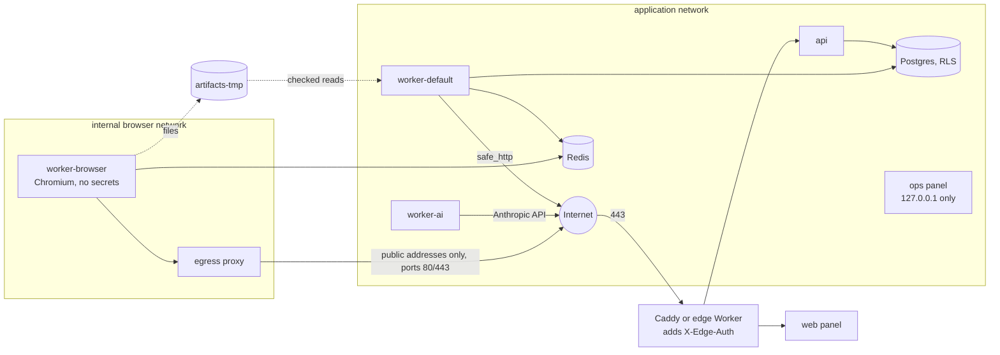

# Security

Kalkan opens hostile websites, reads e-mail from strangers, stores evidence that has to hold up in front of an abuse desk and sends notices on a customer's behalf. This document lists the threats that follow from that, the control for each one, where the control lives in the code and which tests check it. Paths are relative to the repository root.

The threat list is [architecture.md §24](architecture.md). The controls were checked against the current code, for both ways of running Kalkan: a self-hosted server ([deploy/selfhost](../deploy/selfhost/README.md)) and the optional reference cloud deployment ([architecture.md §22](architecture.md)). Settings that only exist in a running deployment (DNS records, CDN settings, an applied Terraform plan) cannot be verified from the repository; they are listed under [Deployment checks](#deployment-checks).

## Trust boundaries

Untrusted input enters in four places: candidate web pages (worker-browser and the HTTP pre-check), RDAP and DNS answers, inbound e-mail (abuse replies) and the public endpoints (login, evidence pages, webhooks). Each crossing has a control below.

## Threats and controls

| # | Threat | Control | Implementation | Tests |
| --- | --- | --- | --- | --- |
| 1 | SSRF from candidate URLs; access to the cloud metadata server or internal services | Every server-side request to a candidate goes through the SSRF-safe client. The browser has no route out except a proxy that applies the same address rules. | `backend/src/kalkan/net/safe_http.py` resolves each host and connects only to addresses that pass `is_public` (no loopback, RFC 1918, link-local, CGNAT, ULA, reserved or IPv4-mapped forms of those); every redirect is checked again. Self-hosted: worker-browser sits on an `internal: true` network with Redis and `egress-proxy` (`backend/src/kalkan/net/egress_proxy.py`), which checks the target once and connects to the checked address, allows ports 80 and 443 only, and limits head size, connection count and idle time. Reference VM: a residential proxy plus `DOCKER-USER` firewall rules (`infra/compose/vm/bin/firewall.sh`). A capture never runs without a proxy (`workers/capture.py` defers the job). WebRTC's non-proxied UDP is off (`scanning/capture.py`). The report printer has its own Chromium that can resolve and reach only the print base URL (`reports/printing.py`). `SSRF_ALLOW_CIDRS` is refused when `ENV=prod` (`config.py`). | `tests/unit/test_safe_http.py`, `tests/unit/test_egress_proxy.py` (refused addresses, DNS rebinding, ports, limits), `tests/unit/test_compose_security.py`, `tests/unit/test_selfhost_compose.py`, `tests/unit/test_report_print_base_url.py`, `tests/unit/test_config.py` |
| 2 | Malicious page or browser exploit | Chromium is treated as compromised: it holds no secrets and can reach almost nothing. | worker-browser runs as `pwuser` with `cap_drop: [ALL]`, `no-new-privileges` and Chromium's own sandbox under a seccomp profile (`infra/compose/vm/seccomp-chromium.json`; never `--no-sandbox`). Downloads and service workers are off, each job gets a new context, the browser restarts every 50 jobs (`RESTART_EVERY`) and a watchdog kills hung pages. Proxy credentials stay in a local forwarder, not in Chromium or the HAR (`scanning/proxy_forwarder.py`). worker-default reads the files the browser leaves only by known names, with `O_NOFOLLOW`, size limits and magic-byte checks (`scanning/persist.py`). | `tests/unit/test_compose_security.py`, `tests/unit/test_capture_forwarder.py`, `tests/unit/test_persist_folder.py`, `tests/integration/test_capture_pipeline.py` |
| 3 | Prompt injection from pages, RDAP data or e-mail | The model sees untrusted text only inside labeled blocks, has no tools and its output is validated. Code makes the decision. | Prompts wrap input in `<untrusted_page_content>`, `<untrusted_domain_data>`, `<untrusted_registration_data>` and `<untrusted_email>` (`ai/prompts/`). Requests define no tools (`ai/client.py`); output is parsed with `model_validate_json` against `ai/schema.py`. `decision/rules.py` cross-checks the verdict with code signals (forms, visual similarity) and sends conflicts to review. With `AI_ENABLED=false` there is no model at all and such cases go to review (`decision/without_ai.py`). | `tests/unit/test_ai_prompt.py`, `tests/unit/test_ai_client.py`, `tests/unit/test_decision_rules.py`, `tests/unit/test_ai_optional.py` |
| 4 | Second-order injection into notice text | The AI paragraph is checked before it goes into a notice; anything suspicious is replaced by a fixed paragraph. Legal text is never generated. | `notices/text.py` `validate()` limits length and rejects URLs, e-mail addresses and obfuscated forms; a failed check falls back to the template (`explanation_source`). Legal paragraphs are fixed files in `notices/legal/`. | `tests/unit/test_notice_text.py`, `tests/unit/test_notice_templates.py` |
| 5 | Data leaking between customers | Row-level security in Postgres, plus the application's own filter. | RLS with a `tenant_isolation` policy on every tenant table (`alembic/versions/0001_initial_schema.py`). The API connects as `kalkan_api` and works only inside `api_session(customer_id)`. IDs are UUIDs and another tenant's object answers 404. | `tests/integration/test_tenant_isolation.py` (every endpoint with two tenants), `tests/integration/test_api_role.py` |
| 6 | Excessive database privileges | Application roles are ordinary login roles. | `backend/sql/bootstrap_roles.sql` creates `kalkan_api` and `kalkan_worker`; only `kalkan_owner` (migrations) owns the schema. Workers get access through an explicit `worker_all` policy. | `tests/integration/test_database_roles.py` |
| 7 | Account takeover | Strong password hashing, mandatory TOTP and hardened sessions. | `security.py` uses argon2id; TOTP is required for every user and operator, and its secrets are encrypted with `TOTP_ENCRYPTION_KEY`. Only hashes of session tokens are stored. Login attempts are limited (`auth_attempts`, "Too many attempts"). Writes need a CSRF header (`api/v1/deps.py`). Cookies are `HttpOnly`, `SameSite=Lax` and `Secure` outside `ENV=local` (`api/v1/auth.py`). | `tests/integration/test_api_auth.py`, `tests/unit/test_hostnames_and_security.py` |
| 8 | Exposure of the ops panel | Not reachable from the internet. | The ops panel and the monitoring UIs bind to `127.0.0.1` on the server (self-hosted compose and `infra/compose/docker-compose.vm.yml`); operators use an SSH tunnel (IAP on the reference VM). Separate staff accounts with TOTP, an audit log of operator actions, CSRF tokens, a strict CSP and `X-Frame-Options: DENY` (`ops/app.py`). Exporters publish no ports and expose counts only. | `tests/unit/test_selfhost_compose.py` (only Caddy is public), `tests/unit/test_ops.py`, `tests/integration/test_ops.py` |
| 9 | Secret leaks | Secrets never enter the repository, logs or error reports. | Self-hosted: `deploy/selfhost/init-env.sh` generates random secrets into a `chmod 600` `.env`. Reference cloud: Secret Manager with per-secret access, per-service tmpfs files on the VM, no service-account keys (workload identity federation), database passwords kept out of Terraform state (K78). Settings never echo values in validation errors (`hide_input_in_errors`). Logs redact secrets and evidence tokens (`logging.py`); Sentry runs with `send_default_pii=False` and URL scrubbing (`sentry.py`). worker-browser gets no database URL, cloud identity or API key, only its own Redis user. gitleaks runs in pre-commit and over the full history in CI. | `tests/unit/test_logging.py`, `tests/unit/test_sentry.py`, `tests/unit/test_config.py`, `tests/unit/test_selfhost_compose.py` |
| 10 | Forged webhooks | Inbound mail and bounce webhooks need a shared secret; events are processed once. | Postmark webhooks use HTTP basic auth (`POSTMARK_WEBHOOK_BASIC_AUTH`) compared with `hmac.compare_digest` (`api/webhooks.py`); the `webhook_events` table makes them idempotent. With plain SMTP there is no inbound webhook at all. | `tests/integration/test_api_auth.py`, `tests/integration/test_followup.py`, `tests/unit/test_replies.py` |
| 11 | Abuse of evidence links | Links are unguessable, expire and leave no trace in logs. | 32-byte random tokens; only their SHA-256 is stored; valid for 90 days and revocable (`notices/evidence.py`). The evidence pages are rate limited per IP (60 a minute), sent with `X-Robots-Tag: noindex` and a strict CSP (`api/evidence.py`). Tokens are removed from request logs (`logging.py` `redact_path`) and Sentry (K79, K84). | `tests/integration/test_api_auth.py`, `tests/integration/test_notices.py`, `tests/unit/test_logging.py`, `tests/unit/test_sentry.py` |
| 12 | A wrong notice | Several independent gates stand between a detection and a real e-mail. | Whitelist first; automatic approval is off by default (`decision/rules.py`, `auto_approve_enabled`). The sending gates run in a fixed order: monitor-only, sending off, suspended, dry-run, kill switch, daily channel limit, no LOA, legal review (`notices/gates.py`, architecture.md §15). `NOTICES_DRY_RUN=true` is the default and redirects everything to `DRY_RUN_REDIRECT_EMAIL`; the global send switch starts off (migration default). "This is our site" retracts sent notices (`notices/retraction.py`). | `tests/integration/test_notices.py`, `tests/unit/test_notice_planner.py`, `tests/integration/test_decision.py` |
| 13 | Accidental production actions | A developer machine cannot reach real recipients, and nothing deploys on its own. | `ENV=local` refuses `EMAIL_PROVIDER=postmark` (`email/provider.py`); locally all mail goes to Mailpit. The repository ships no deploy workflow; the reference deployment's identity federation trusts only a manual run of a workflow you add yourself, on `main`, started by one named account (`infra/terraform/wif.tf`, K76). Tests make no real network calls (`httpx2` mock transports, `responses`, fixture sites). | `tests/unit/test_email_provider.py` |
| 14 | Sender reputation | Notices come from a dedicated sending domain with bounce handling. | `MAIL_FROM` on its own domain; a Postmark bounce marks the notice `failed` and opens an operator task. SPF, DKIM and DMARC live in DNS (see [Deployment checks](#deployment-checks)). | `tests/integration/test_notices.py` |
| 15 | Crossing legal lines while scanning | No CAPTCHA solving, no bot-protection bypass, no stealth. | `scanning/patterns.py` only recognizes challenge pages and sends the case to a person. No stealth or evasion plugins; automation markers are left as they are (`scanning/profiles.py`). Real notices also need an LOA and approved legal text (`notices/gates.py`). | `tests/unit/test_scanning.py`, `tests/unit/test_capture_profiles.py` |
| 16 | Data loss | Backups for the database, write-once evidence. | Self-hosted: `pg_dump` plus an archive of the `objects` volume, documented in [deploy/selfhost/README.md](../deploy/selfhost/README.md). Reference cloud: daily Cloud SQL backups (7 kept) with an alert on failure, a restore drill script (`infra/scripts/restore-drill.sh`) and a 180-day bucket retention policy. Evidence is never overwritten on either backend (see [Storage](#filesystem-storage)). | `tests/unit/test_storage_filesystem.py`, `tests/integration/test_storage.py` |
| 17 | Supply chain | Locked dependencies and pinned versions, watched by Dependabot. | `backend/uv.lock`, `web/package-lock.json` and `infra/cloudflare/package-lock.json`; image tags and GitHub Actions pinned (Actions by SHA). Dependabot covers uv, npm (web and edge Worker), Docker, Compose, Terraform and GitHub Actions (`.github/dependabot.yml`). | CI |

## Self-hosting controls

The self-hosted setup has no cloud firewall, metadata server protection or managed secret store, so a few controls exist only for it.

### Egress proxy

`python -m kalkan.net.egress_proxy` is the browser's only way to the internet on a self-hosted server.

- It resolves each target once, with the same resolver and the same `is_public` test as `safe_http`, and answers `403` when any address of the host is not public.
- It connects to the address it checked, never to the name, so a second DNS answer cannot rebind the connection to an internal service.
- It allows only the configured ports (80 and 443 by default), for CONNECT tunnels and plain-http requests alike.
- One request per client connection; plain-http requests go upstream with `Connection: close`.
- The request head is capped at 16 KiB and must arrive within 15 seconds; at most 256 clients are served at once, and idle connections close after 60 seconds.
- Refusals are logged with the host and the reason only. Paths and query strings are never logged, since they may carry tokens.

The proxy has no authentication. It is safe only because it sits on the internal `browser` network, which nothing else joins. Do not publish its port.

### Filesystem storage

With `STORAGE_BACKEND=filesystem` evidence and reports are files under `STORAGE_ROOT` (`backend/src/kalkan/storage/filesystem.py`):

- **Write-once.** Bytes go to a temporary file, are fsynced and are published with `os.link`, which fails if the name exists. Of two concurrent writers exactly one wins; a reader never sees a partial object.
- **Integrity.** The SHA-256 is computed before writing and stored in a metadata file next to the object.
- **No path traversal.** Bucket names follow GCS naming rules. Object paths must be relative and may not contain `.`, `..`, empty segments, NUL or backslashes. The resolved path must stay under the bucket directory, which also stops symlink escapes. `STORAGE_ROOT` must be absolute.
- **No deletes** except demo objects under `demo/`.
- Files are created with mode `0640`.

Tests: `tests/unit/test_storage_filesystem.py` (traversal attempts, symlinks, concurrent writers, delete limits) and `tests/integration/test_storage_filesystem.py`.

### SMTP credentials

`EMAIL_PROVIDER=smtp` reads one `SMTP_URL` (`backend/src/kalkan/email/provider.py`):

- `smtp+starttls://` (port 587) and `smtps://` (port 465) carry credentials; TLS uses certificate verification.
- A user or password over plain `smtp://` is refused at startup, since AUTH would send the password in the clear. Plain `smtp://` is meant for Mailpit or a relay on the same host.
- A user without a password, or the reverse, is refused.
- The password is percent-decoded, never appears in exceptions or `repr`, and a refused login reports only the server's code.

Tests: `tests/unit/test_email_provider.py`.

### Production-mode guards

The self-hosted compose file sets `ENV=prod` for every backend service. With it:

- the api refuses requests without `X-Edge-Auth`. Caddy adds the header to every request it forwards and replaces any header a client sends (`api/middleware.py`, `deploy/selfhost/Caddyfile`);
- cookies are `Secure`;
- `SSRF_ALLOW_CIDRS` and `STORAGE_EMULATOR_HOST` are refused at startup (`config.py`).

Caddy also sets HSTS and drops the `Server` header, and its admin endpoint is off. Redis requires a password, and worker-browser has a separate Redis user limited to its own queues (`deploy/selfhost/redis/start.sh`).

### Running without AI

With `AI_ENABLED=false` no page content reaches a model. The cases that would have been classified go to the review queue with the reason `ai_disabled`, and nothing is approved, dismissed or sent automatically (`decision/without_ai.py`, `workers/without_ai.py`). Tests: `tests/unit/test_ai_optional.py`, `tests/integration/test_ai_optional.py`.

## Residual risks

These are accepted, or depend on how a deployment is run.

- **Evidence page rate limit** is kept in each process's memory. With several api instances the effective limit grows with the instance count. Tokens cannot be guessed, so the risk is low; a CDN or Caddy rate limit can be added.
- **Filesystem evidence is only as immutable as the host.** Kalkan never overwrites or deletes evidence, but root on the server can. A cloud bucket with a retention lock is stronger; locking it cannot be undone.
- **Self-hosted pages leave from the server's own IP address.** Hostile sites can see and block it. There is no per-country exit.
- **The egress proxy has no authentication.** Its isolation depends on the Docker network layout. Optional extra layer: the `DOCKER-USER` firewall rules in `infra/compose/vm/bin/firewall.sh`.
- **Chromium's sandbox needs unprivileged user namespaces.** On Ubuntu 23.10 and later AppArmor restricts them and captures fail until the host allows them. The sandbox is never turned off as a workaround.
- **Redis uses `noeviction`.** During a long CT burst the capture queue grows until Redis memory runs out and writes are refused. The queue-backlog alarm fires long before that. See [load-test.md](load-test.md).
- **Replies over plain SMTP are not read in.** Abuse desk replies reach the sender mailbox, and an operator has to read them there.

## Deployment checks

These cannot be verified from the repository and should be checked on every deployment:

- SPF, DKIM and DMARC records for the sending domain, aligned with `MAIL_FROM`.
- HSTS on the public names (Caddy sets it; in the reference cloud deployment it is a Cloudflare setting).
- Only ports 80 and 443 (and SSH) open to the internet.
- `NOTICES_DRY_RUN`, the global send switch and each customer's dry-run set as intended before real sending.
- A copy of `.env`, in particular `TOTP_ENCRYPTION_KEY`, stored outside the server.
- A restore from backup tried at least once.
