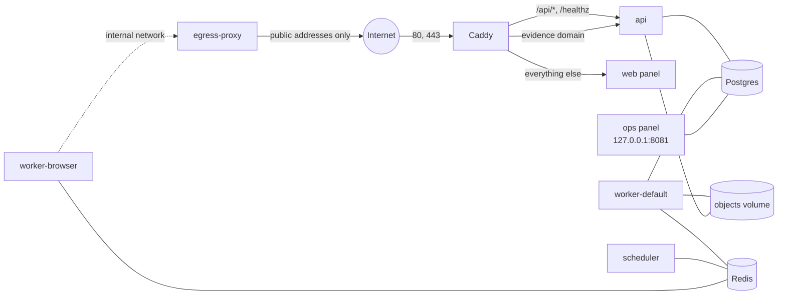

# Self-hosting Kalkan

Kalkan runs in two ways without any cloud account:

| Where | Command | What you get |
| --- | --- | --- |
| A laptop | `make demo` | The whole application on `localhost` with the fictional Mintera Bank workspace, mail caught by Mailpit and no domain needed |
| One Linux server | `deploy/selfhost` (Docker Compose and Caddy) | A real deployment with HTTPS, your SMTP server and real discovery |

The Google Cloud and Cloudflare setup under `infra/` is an optional reference deployment ([architecture.md §22](architecture.md)). Nothing on this page needs it.

Day-to-day operation (the ops panel, alarms, incidents, restores) is in [operations.md](operations.md). Building and testing the code is in [development.md](development.md).

## On a laptop

### Requirements

- Docker Engine or Docker Desktop with the Compose plugin (Docker 27+, Compose v2.24+), and `make`.
- A few GB of free RAM, and disk space for the images: about 2 GB for the demo, plus about 6 GB for the browser image (`make demo-browser`).
- Nothing else: Python, Node.js and the database all run in containers.

### Start the demo

```sh
git clone <this repository> kalkan && cd kalkan
make demo
```

`make demo`:

1. creates `.env` from `.env.example` if it is missing (it never overwrites an existing `.env`);
2. builds the images and starts Postgres, Redis, a storage emulator (fake-gcs), Mailpit, the API, the default worker, the scheduler, the ops panel and a production build of the customer panel, waiting until all are healthy (database migrations run first);
3. seeds the Mintera Bank demo workspace, whose overview shows 128 detected sites, 47 verified and 39 taken down, with every date moved relative to today;
4. creates or renews the ops operator `operator@kalkan.local`;
5. prints the URLs and every login.

The first build takes a few minutes. Running `make demo` again re-seeds the workspace and issues new passwords.

AI stays off unless you add an Anthropic key (see [Turn on AI](#turn-on-ai)), so the demo costs nothing and makes no calls to external services.

### Addresses and ports

Every port binds to `127.0.0.1` only.

| Service | Default address | Variable |
| --- | --- | --- |
| Customer panel | http://localhost:3000 | `WEB_PORT` |
| Ops panel | http://localhost:8081 | `OPS_PORT` |
| API and its docs | http://localhost:8000/api/docs | `API_PORT` |
| Mailpit (every e-mail the stack sends) | http://localhost:8025 | `MAILPIT_PORT` |
| Postgres, Redis, fake-gcs | 5432, 6379, 4443 | `POSTGRES_PORT`, `REDIS_PORT`, `FAKE_GCS_PORT` |
| Mailpit SMTP, fixture sites, dev-proxy | 2525, 18080, 18888 | `MAILPIT_SMTP_PORT`, `FIXTURE_SITES_PORT`, `DEV_PROXY_PORT` |

If a port is taken, move it. You can do it for one run:

```sh
API_PORT=8010 make demo
```

To make it permanent, uncomment the line in `.env` instead. Otherwise a later `make` command without the variable moves the service back. `make demo` and `make demo-info` print the ports in use. If you move `POSTGRES_PORT`, `REDIS_PORT`, `FAKE_GCS_PORT` or `MAILPIT_SMTP_PORT`, also change the matching host URLs in `.env`. Only the tests and the CLI on the host use them.

The two compose networks have fixed subnets: `172.30.0.0/16` (with the fixture sites at `172.30.255.80`, the one address the scanner may reach) and `172.29.250.0/24` for the browser. If `make demo` fails with `Pool overlaps with other one on this address space`, one of them clashes with a network on your machine. Move them with variables, for one run or in `.env`:

```sh
KALKAN_SUBNET=172.31.0.0/16 FIXTURE_SITES_IP=172.31.255.80 BROWSER_SUBNET=172.28.250.0/24 make demo
```

`FIXTURE_SITES_IP` must lie inside `KALKAN_SUBNET`; the scanner's allow-list follows it. dev-proxy admits every private range, so no file needs editing. As with ports, set the variables in `.env` so later `make` commands keep them.

To run a second copy of the stack next to a running one (for example a second checkout), give it its own project name, ports and subnets in that checkout's `.env`:

```sh
COMPOSE_PROJECT_NAME=kalkan2
API_PORT=8100
WEB_PORT=3100
OPS_PORT=8181
MAILPIT_PORT=8125
MAILPIT_SMTP_PORT=2625
POSTGRES_PORT=5532
REDIS_PORT=6479
FAKE_GCS_PORT=4543
FIXTURE_SITES_PORT=18180
DEV_PROXY_PORT=18988
KALKAN_SUBNET=172.31.0.0/16
FIXTURE_SITES_IP=172.31.255.80
BROWSER_SUBNET=172.28.250.0/24
```

Its images are named after the project (`kalkan2-backend:local`), so building it leaves the first copy's images alone. For anything the variables do not cover, `COMPOSE_OVERRIDE=my-override.yml` layers an extra compose file on top; pass it to every later `make` command, or export it in your shell.

### Sign in

| Account | Where | Role |
| --- | --- | --- |
| `security@mintera.example` | Customer panel | Owner |
| `analyst@mintera.example` | Customer panel | Viewer (no write buttons) |
| `operator@kalkan.local` | Ops panel | Operator |

The demo workspace is read-only, even for the owner. Its write controls are disabled.

Passwords and TOTP secrets are printed by `make demo` and stored in `.local/demo-credentials.json`. The file is git-ignored and readable only by you. The `demo-setup` container writes it through a bind mount: it runs as your user and finds the file through `DEMO_CREDENTIALS_FILE`.

Every sign-in asks for a TOTP code, as in production. Either scan the printed `otpauth://` link into an authenticator app, or ask for the current code:

```sh
make demo-code EMAIL=security@mintera.example
make demo-code EMAIL=operator@kalkan.local
```

`make demo-info` prints the URLs and logins again without touching the database.

Things to try:

- **Customer panel.** The overview numbers and charts, the threat list, a threat's detail page (side-by-side screenshots, AI review, infrastructure, timeline, notices, evidence ZIP), the whitelist, the reports and the settings.
- **Ops panel.** The case list, the outbox of dry-run notices, tasks, customers and settings. The demo's cases are excluded from the review queue.
- **Mailpit.** Invitations, password resets and notice previews all land here.

### See captures of the fixture sites

```sh
make demo-browser
```

This is the demo plus `worker-browser` (built on Playwright's image, about 6 GB), the fixture sites and `dev-proxy`. The fixture sites are fictional pages served under `*.test` names: the official Mintera Bank site, a clone, a lure page, a parked page and others ([fixtures/sites/README.md](../fixtures/sites/README.md)). `dev-proxy` is a tinyproxy that reaches only those names. Chromium sits on an internal network and has no other way out.

The demo workspace never matches new domains, so create a small trial customer and give it the clone as a candidate. Run these from the repository root:

```sh
dc() { docker compose --env-file .env -f infra/compose/docker-compose.yml ${COMPOSE_OVERRIDE:+-f "$COMPOSE_OVERRIDE"} "$@"; }

dc exec ops kalkan customer create "Capture Trial" --slug capture-trial --monitor-only
dc exec ops kalkan brand add "Mintera Bank" --customer capture-trial --keyword mintera --market PL
# Use the brand id printed above:
dc exec ops kalkan official-domain add mintera.test --brand <brand-id>
dc exec ops kalkan candidate add http://mintera-login.test/ --brand <brand-id>
```

Within a minute the case goes from `detected` through the HTTP pre-check and the browser capture to review. The trial case is the newest one on the ops panel's **Cases** page (the seeded demo cases come first, so its number is in the hundreds). Show it with that number:

```sh
dc exec ops kalkan case show KLK-000NNN   # NNN: the trial case's number from the Cases page
```

Open the ops panel's **Review** page to see the desktop and mobile screenshots of the clone next to the official site's references, the similarity signals and the review reason. Without AI the reason is `ai_disabled`. `--monitor-only` keeps the trial customer from ever sending a notice, even as a preview. Try `http://mintera-verify.test/` (the lure page) the same way: its buttons point at the clone and at a third-party site, which become new candidates.

### Turn on AI

AI is optional. Without it, every case that would go to the model goes to the review queue, notices use a fixed explanation paragraph, and replies wait for the operator.

To try it, put your key in `.env` (`ANTHROPIC_API_KEY=...`) and run:

```sh
make up-ai
```

This starts `worker-ai`. Because `.env` now has a key, `AI_ENABLED` also turns on for the other services. New cases, such as the capture trial above, then get a triage verdict and, when it is needed, a confirmation. The seeded demo cases already have verdicts. Real API calls cost money, and `AI_MONTHLY_BUDGET_USD` (default 50) caps the monthly spend.

A variable in your shell overrides `.env`. `make demo` and `make demo-browser` never start `worker-ai`, so they set `AI_ENABLED=false` unless your shell sets `AI_ENABLED`, even when `ANTHROPIC_API_KEY` is exported in your shell. With `make up`, an exported key turns AI on for the other services although nothing runs `worker-ai`: unset it, or set `AI_ENABLED=false`.

### Stop and reset

```sh
make demo-down    # stop everything (every profile); data is kept
make demo-reset   # stop and delete the volumes: database, stored objects, browser hand-off
```

`make demo-reset` asks you to type the compose project name it prints (`kalkan` by default) first. `.env` and `.local/` stay. Run `make demo` again for a fresh start.

## On one Linux server

[deploy/selfhost/README.md](../deploy/selfhost/README.md) is the step-by-step guide and the reference for every setting. This section gives the overview and covers what that guide leaves out.



### What you need

- A Linux server with Docker Engine 28+ and Compose v2.33+. The `monitoring` profile needs these versions. Without it, Docker 27 and Compose 2.24 are enough.
- 2 vCPU, 4 GB RAM and 20 GB of disk; with the `browser` profile, about 4 GB more (8 GB total).
- Two DNS names with A (and AAAA, if the server has IPv6) records pointing at the server, for example `app.example.com` for the panel and API and `evidence.example.com` for the evidence pages that abuse desks open.
- Ports 80 and 443 reachable from the internet. Caddy uses them to get Let's Encrypt certificates and to serve the site.
- An SMTP server that accepts mail from your sender address.

### Install

```sh
git clone <this repository> kalkan && cd kalkan/deploy/selfhost
./init-env.sh
$EDITOR .env
docker compose up -d --build
docker compose exec ops kalkan staff create you@example.com --generate-password
```

- **Secrets.** `init-env.sh` copies `.env.example` to `.env` with mode 600. It replaces every `change-me` value with 32 random bytes in hex, so the passwords go into connection URLs without escaping, and `TOTP_ENCRYPTION_KEY` with a Fernet key. It needs only bash, `od` and `/dev/urandom`, and it refuses to overwrite an existing `.env`.
- **What to edit.** Set `APP_DOMAIN`, `EVIDENCE_DOMAIN`, `ACME_EMAIL`, `SMTP_URL`, `MAIL_FROM` and `DRY_RUN_REDIRECT_EMAIL`. `COMPOSE_PROFILES` turns on the optional parts (below).
- **HTTPS.** Caddy is the only container with public ports. It obtains and renews the certificates for both names, sends `/api/*` and `/healthz` to the API and the rest of the app domain to the panel, and adds the `X-Edge-Auth` header the API requires with `ENV=prod`.
- **First operator.** `kalkan staff create` prints the password and the TOTP secret once.

### Reach the ops panel

The ops panel, Prometheus, Alertmanager and Grafana listen on `127.0.0.1` on the server. Use an SSH tunnel:

```sh
ssh -N -L 8081:127.0.0.1:8081 -L 9090:127.0.0.1:9090 -L 9093:127.0.0.1:9093 -L 3001:127.0.0.1:3001 you@server
```

Then open http://localhost:8081. Create the first customer, its brands, official domains and whitelist there, and invite the customer's users. The invitation e-mail links to `https://APP_DOMAIN`. All of this is also available on the command line: `docker compose exec ops kalkan --help`.

### Optional profiles

Set `COMPOSE_PROFILES` in `.env` (comma-separated), then run `docker compose up -d --build`.

| Profile | Adds | Without it |
| --- | --- | --- |
| `browser` | `worker-browser` (Chromium screenshots, forms and links, the monthly report PDF) and `egress-proxy` | Capture jobs wait in the queue; nothing is lost. Cases cannot be verified with screenshots and no report PDF is printed |
| `ai` | `worker-ai` (triage, confirmation, notice text, reply classification) | Cases go to the review queue (`ai_disabled`) |
| `ct` | `certstream` and `ct-consumer`: new TLS certificates from the public CT logs, matched against your brands within seconds | Discovery relies on dnstwist permutations, CZDS (if configured) and manual candidates |
| `monitoring` | Prometheus, Alertmanager (alarms by SMTP), Grafana, node-exporter | No alarms. The ops panel's System page still shows queues and spend |

Turning a profile off in `.env` does not stop its running containers. Remove them yourself, for example `docker compose rm -sf worker-browser egress-proxy`.

### Optional integrations

Each one is off while its setting is empty.

| Integration | Settings | What it adds |
| --- | --- | --- |
| Anthropic (Claude) | `ANTHROPIC_API_KEY`, the `ai` profile, `AI_MONTHLY_BUDGET_USD` | A model reads the screenshots and page text and classifies the site. Cases it is sure about skip the review queue (only once you turn on `auto_approve_enabled`). It also writes the explanation paragraph of each notice and classifies replies. Costs money. When the budget is spent, new cases go to review |
| ICANN CZDS | `CZDS_USERNAME`, `CZDS_PASSWORD`, `CZDS_TLDS` | A daily scan (06:30 UTC) of the zone files of the TLDs your CZDS account is approved for. It finds registered look-alike domains before they have a certificate or a website. Empty `CZDS_TLDS` scans every approved TLD except `com` and `net`; `*` scans all of them |
| Google Web Risk | `WEBRISK_API_KEY` | Enrichment checks whether Google already lists the site. The result is a signal shown in review |
| Postmark | `EMAIL_PROVIDER=postmark`, `POSTMARK_SERVER_TOKEN`, `POSTMARK_WEBHOOK_BASIC_AUTH`, `REPLY_DOMAIN` | Sending through Postmark's API, and above all the inbound and bounce webhooks. Replies to notices are matched to their case and classified (removed, needs info, not our customer), and bounced addresses open a task. Without them, read replies in the `MAIL_FROM` mailbox yourself |
| Sentry | `SENTRY_DSN` | Errors from every service. Events carry no local variables or request bodies, and the edge header and evidence tokens are scrubbed |
| Residential proxies | none on a self-hosted server | Per-country exit addresses, so geo-fenced phishing pages show the market's version. The self-hosted browser leaves from your server's own IP through `egress-proxy`, which has no upstream proxy. The reference deployment uses `PROXY_MAP` with residential proxies ([architecture.md §10](architecture.md)) |

With plain SMTP, notices carry a `Reply-To` of `case+<number>@REPLY_DOMAIN`. Either receive mail for that domain, or leave `REPLY_DOMAIN` empty so replies go to `MAIL_FROM`.

### Backups

Back up the database and the `objects` volume together, and keep a copy of `.env`. It holds the only copy of `TOTP_ENCRYPTION_KEY`; without it every user and operator has to set up TOTP again.

```sh
cd deploy/selfhost
umask 077                                   # the backups hold every customer's data
BACKUPS=/var/backups/kalkan                 # outside the repository
sudo install -d -m 700 -o "$USER" "$BACKUPS"
docker compose exec -T postgres pg_dump -U postgres -Fc kalkan > "$BACKUPS/kalkan-$(date +%F).dump"
docker run --rm -v kalkan-selfhost_objects:/data:ro -v "$BACKUPS":/backup alpine \
  sh -c "umask 077 && tar czf /backup/objects-$(date +%F).tar.gz -C /data ."
```

The files stay outside the git checkout and are readable only by you (the objects archive by root). Copy both off the server, for example with a nightly cron job and `rsync` or `restic`. Evidence files are written once and never changed, so the objects archive only grows. Restoring and the quarterly restore drill are in [operations.md](operations.md#restore-drill).

### Upgrades

```sh
cd deploy/selfhost
umask 077 && docker compose exec -T postgres pg_dump -U postgres -Fc kalkan > /var/backups/kalkan/kalkan-before-upgrade.dump
git pull
docker compose up -d --build
docker compose ps    # migrate exited 0, everything else healthy
```

The one-off `migrate` service runs `alembic upgrade head` before the application starts. Migrations are written so that the previous release keeps working on the new schema, which keeps a rollback simple ([operations.md](operations.md#rollback)).

### Security notes

- **Exposure.** Only Caddy listens on public ports. The ops panel and the monitoring UIs are on `127.0.0.1`. Postgres and Redis have no published ports at all. Redis requires passwords, and the browser has its own Redis user limited to its queues.
- **`ENV=prod`** turns on secure cookies and the API's `X-Edge-Auth` check. It also refuses test-only settings: `SSRF_ALLOW_CIDRS`, the storage emulator, and the demo commands.
- **The browser is untrusted.** Chromium opens attacker-controlled pages. It runs with its sandbox (never `--no-sandbox`), a seccomp profile, no capabilities and no database or storage credentials. Its only way out is `egress-proxy`, which refuses private, loopback, link-local, CGNAT and metadata addresses and connects to the address it checked. Keep `egress-proxy` on the internal network: it has no authentication.
- **Ubuntu 23.10 and later** restrict unprivileged user namespaces through AppArmor. Chromium's sandbox needs them, so captures fail with `No usable sandbox!` in the `worker-browser` log. The fixes are in [deploy/selfhost/README.md](../deploy/selfhost/README.md#the-browser-and-its-egress-proxy).
- **Notices are simulated until you decide otherwise.** `NOTICES_DRY_RUN=true` sends every notice to `DRY_RUN_REDIRECT_EMAIL`. The legal paragraphs under `backend/src/kalkan/notices/legal/` start with `LEGAL_REVIEW_REQUIRED`, and real sends stop at the `legal_review` gate until a lawyer has reviewed them and you remove that line. The full go-live order is in [operations.md](operations.md#dry-run-and-going-live).
- **Secrets.** `.env` is mode 600. Never change the database passwords in it after the first start: the roles were created with them.
- **Further hardening.** The reference VM also drops traffic from the browser network to private ranges with iptables (`infra/compose/vm/bin/firewall.sh`), as defense in depth. Its threat model and review are in [security.md](security.md).
